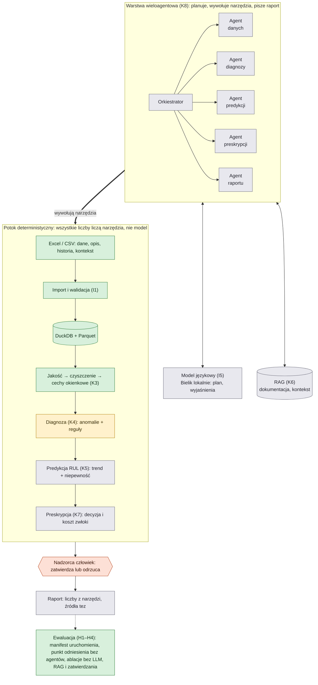

# Architektura systemu diagsys

Legenda: zielony = gotowe (K1–K3, import Excela, szkielet eksperymentów), żółty = następny krok (K4),
szary = zaplanowane, czerwony = decyzja człowieka.

Zasady: model językowy planuje i wyjaśnia, wszystkie liczby liczą narzędzia deterministyczne,
system tylko doradza (brak zapisu do maszyn), a każda teza w raporcie ma źródło.

Potok deterministyczny jest jednocześnie punktem odniesienia w eksperymentach (H1–H4): warstwa
agentowa działa na tych samych narzędziach, więc porównanie "potok bez agentów a system
wieloagentowy" mierzy wkład agentów, a nie różnicę w obliczeniach.

Obraz: `docs/architektura.png` (render z `docs/architektura.mmd`: `mmdc -i docs/architektura.mmd -o docs/architektura.png -s 2`).
